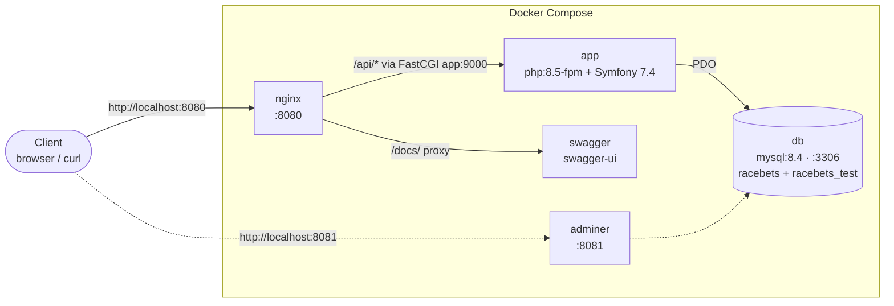
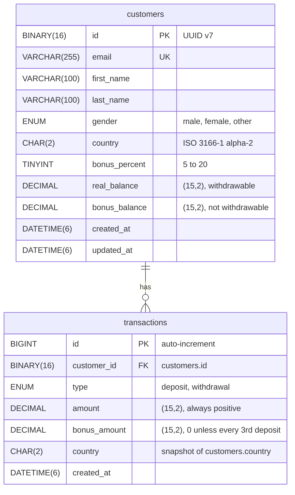

# RaceBets API

The OpenAPI spec is [docs/openapi.yaml](docs/openapi.yaml).

## Endpoints

Requests and responses are JSON. Request bodies must be sent with `Content-Type: application/json`.

| Method | Path | Purpose | Success |
|---|---|---|---|
| `POST` | `/api/customers` | Create a customer | `201` + customer |
| `GET` | `/api/customers/{id}` | Read a customer with balances | `200` + customer |
| `PATCH` | `/api/customers/{id}` | Edit registration details (partial update) | `200` + customer |
| `POST` | `/api/customers/{id}/deposits` | Deposit money | `201` + transaction + new balances |
| `POST` | `/api/customers/{id}/withdrawals` | Withdraw money | `201` + transaction + new balances |
| `GET` | `/api/reports/daily-transaction-totals?from=YYYY-MM-DD&to=YYYY-MM-DD` | Daily totals per country (range of at most 3 months) | `200` + report rows |

## Currency

The only currency considered in this project is **EUR**. Each customer has a single set of balances (real and bonus) with no currency attached: the API never accepts or returns a currency code, the database stores none, and the `Money` value object holds only an amount. Amounts are decimal strings with two decimals (e.g. `"100.00"`) and are always EUR.

## Tech Stack

- **PHP 8.5**, with `ext-bcmath` for money arithmetic
- **Symfony 7.4 LTS**, started from `symfony/skeleton`
- **Pest 4** for unit, integration, API and architecture tests
- **MySQL 8.4**, accessed through plain PDO (no Doctrine)
- **nginx + php-fpm** on Docker Compose
- **PHPStan** and **PHP-CS-Fixer** for static analysis and code style
- **OpenAPI 3.1**, hand-written and served by Swagger UI

## Local Setup

Requirements: Docker with Docker Compose, and `make`.

```bash
git clone https://github.com/faicchia/betsson-racebets-test.git && cd betsson-racebets-test
make up      # build and start all containers
make test    # run the test suite
```

On first start the `app` container runs `composer install`, and MySQL creates the `racebets` and `racebets_test` databases from `docker/mysql/schema.sql`. The app database is seeded with dummy customers and transactions; the test database stays empty.



Editable source: [docs/diagrams/local-setup.drawio](docs/diagrams/local-setup.drawio).

| Service | Image | URL / port | Purpose |
|---|---|---|---|
| `nginx` | `nginx:stable-alpine` | <http://localhost:8080> | Serves `public/`, passes PHP to `app`, proxies `/docs/` to `swagger` |
| `app` | built from `php:8.5-fpm` | (internal) `9000` | Runs Symfony under php-fpm with 10 static workers |
| `db` | `mysql:8.4` | `localhost:3306` | App database `racebets` and test database `racebets_test` (user `user`, password `123456`) |
| `swagger` | `swaggerapi/swagger-ui` | <http://localhost:8080/docs/> | Renders `docs/openapi.yaml` |
| `adminer` | `adminer` | <http://localhost:8081> | Database browser |

Swagger UI is at <http://localhost:8080/docs/> once the containers are up.

**Make targets**

| Command | What it does |
|---|---|
| `make help` | List available commands (default target) |
| `make up` | Build and start all containers in the background |
| `make down` | Stop and remove all containers |
| `make build` | Rebuild the app image |
| `make ps` | List all containers |
| `make restart` | Restart all containers (`down` + `up`) |
| `make logs` | Follow the container logs |
| `make shell` | Open a shell in the `app` container |
| `make composer` | Run Composer in the `app` container, e.g. `make composer c="require foo/bar"` |
| `make console` | Run `bin/console` in the `app` container, e.g. `make console c="debug:router"` |
| `make db-reset` | Wipe the database volume and recreate both databases from `schema.sql` (deletes all data) |
| `make test` | Run Pest, e.g. `make test c="--testsuite=Unit"` or `c="--filter=customer"` |
| `make lint` | Check the code style with PHP-CS-Fixer, showing what would change |
| `make lint-fix` | Fix the code style with PHP-CS-Fixer |
| `make lint-config` | Lint `composer.json`, the YAML config and the service container |
| `make stan` | Run PHPStan static analysis |

## Database Schema

One customer has many transactions. `transactions` is an append-only ledger: one row per successful deposit or withdrawal, linked to its customer through `customer_id`.



Editable source: [docs/diagrams/schema.drawio](docs/diagrams/schema.drawio).

- `customers` (1) → `transactions` (0..N): a new customer has no transactions, and each transaction belongs to exactly one customer (`fk_transactions_customer`).
- Balances live on `customers`. Each deposit or withdrawal locks the customer row (`SELECT … FOR UPDATE`), updates the balances and inserts a ledger row in the same DB transaction.
- `transactions.country` copies the customer's country at the time, so editing a customer's country never changes past reports.

The full DDL is in [docker/mysql/schema.sql](docker/mysql/schema.sql).
